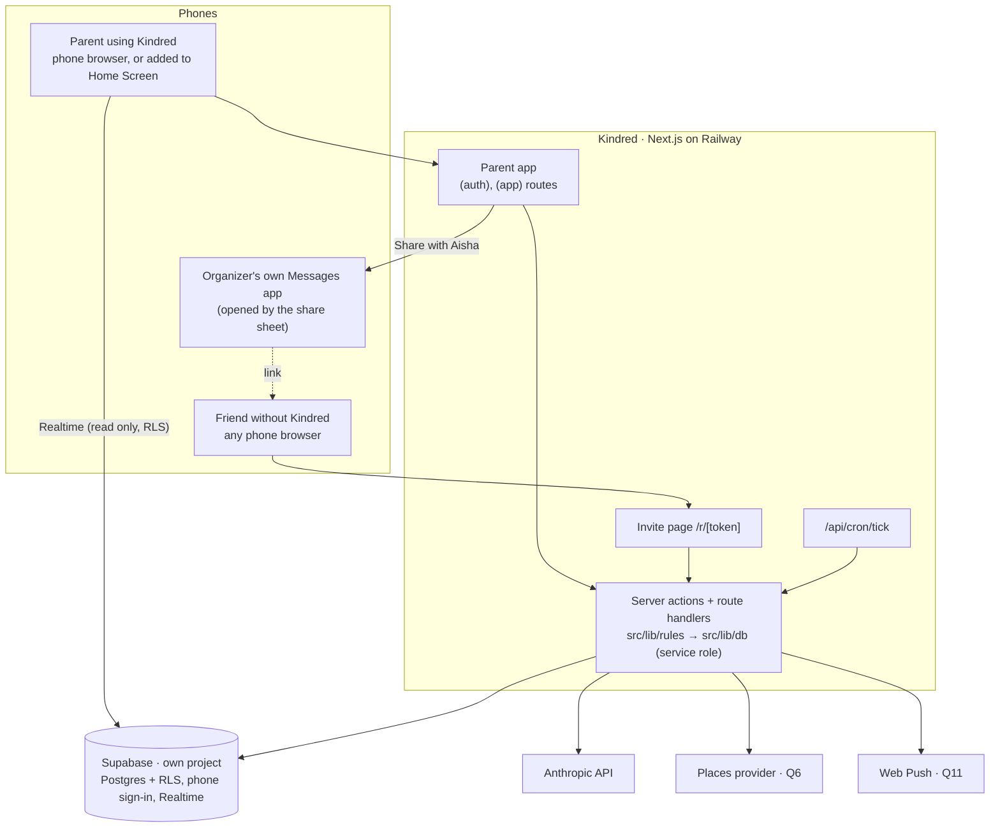

# DESIGN — Kindred

As of 2026-11-14. Source: "Kindred: Product & Design Document" (claude.ai doc, 2026-11-14) and its clickable prototype ("Kindred app preview"). Where this file and the doc disagree, the doc wins for **what the parent sees**; this file wins for **how it is built**. Decisions made here that the doc does not cover are marked *(build decision)*.

**Platform:** the doc describes a native mobile app. It is built here as a mobile-first web app on the owner's stack (Next.js on Railway + Supabase, as Lash and Aquatix). What that changes for parents is listed under "Platform" below; everything else follows the doc.

## Summary
Kindred is a mobile app that lets a parent plan a playdate with families they already know, in a few taps, without the group-chat back and forth. Friends answer in the app, or from a text message link with nothing to install.

- **For:** parents of children roughly 2 to 10 who already have other parents' numbers (school, daycare, classes, neighbourhood).
- **Problem:** a playdate today is a long text thread. Times get lost, one family waits on another, nobody is sure what was agreed. With three or more families it often never happens.
- **Loop:** the organizer picks friends, a time and a place, and writes a short message → each friend answers with one tap → the organizer sees answers live and confirms → everyone gets the update.

## Design principles (from the doc; every task respects them)
1. **The organizer is always in control.** Nothing is confirmed until they tap Confirm; they can edit at any time and send an update.
2. **Friends never need the app.** A text with a link does everything the app does for an invited parent.
3. **Personal, not formal.** The parent writes the message; the app adds no generic wording.
4. **Calm and simple.** One main action per screen, few words, only what matters right now on Home.
5. **Private by default.** Friends and groups belong to each parent and are never shown to anyone else.

## Platform *(build decision)*
One Next.js app on Railway, one Supabase project per environment, the same stack and habits as Lash and Aquatix.

- **One place for the rules:** `src/lib/rules` (pure TypeScript). Pages, server actions, the invite page and the cron job all call it. The database only accepts writes from the server (service role) and still guards the invariants with constraints (`docs/schema.test.sql`).
- **Texts come from the organizer's own number.** Kindred never sends invite texts from a server. After sending, the app shows a **Share with Aisha** button per friend; it opens the phone's share sheet with the parent's message and that friend's link, the organizer picks Aisha from their own contacts (Messages, WhatsApp…) and taps Send (Q26, owner's answer 2026-11-16). Kindred keeps no friend's phone number: a number typed when adding a friend only makes the keyed hash that says whether they use Kindred. No SMS provider is needed for invites; only the sign-in code uses one (Supabase phone sign-in, Q10).

### What the web platform changes from the doc
| The doc (native app) | Here | Notes |
| --- | --- | --- |
| Pick friends from the phone's contacts | **Add a friend:** "Choose from contacts" where the browser supports the Contact Picker (Android Chrome); everywhere else, name, child's name and number typed in, with "Paste a number" | iPhone browsers have no contact picker (Q15). Only chosen contacts leave the phone either way. |
| The phone's Messages app opens addressed to the friend | The phone's share sheet, one **Share with …** button per friend; the parent picks the person from their own contacts | Each friend has their own link, so one tap per friend (Q3); no stored number (Q26). |
| Push notifications | Web Push for parents who added Kindred to their Home Screen; otherwise updates show in the app | iPhone needs iOS 16.4+ and Home Screen install (Q11). |
| Add to calendar | `.ics` download on the invite page and in the app | Works on every phone. |
| App Store / TestFlight | A URL; "Add to Home Screen" prompt after the first playdate | A native wrapper can come later if parents ask (Q15). |
| Friends with the app get the invite in the app | Friends with Kindred see it on their Home; if they have no push, the organizer also gets a **Text** button for them (Q11 default) | A web app can't reach them otherwise. Same invite page for everyone. |

## Repo layout
See `CLAUDE.md` "Layout". The parent app lives under `src/app/(auth)` and `src/app/(app)`; the invite page under `src/app/r/[token]`; rules in `src/lib/rules`; repositories in `src/lib/db`; services in `src/lib/domain`; strings in `src/lib/i18n/en-CA.ts`.

## Core concepts
| Term | Meaning |
| --- | --- |
| Organizer | The parent who plans the playdate. Only they can confirm, edit or cancel it. |
| Friend | Another parent, picked from the organizer's phone contacts, shown with their child ("Arjun's dad"). |
| In the app / by text | A friend with Kindred gets the invite in the app; a friend without it gets a text from the organizer's own phone with a link to a web page. |
| Group | Optional private list of friends ("Dance friends"). Only the organizer sees it. |
| Playdate | One plan: who is invited, when, where, a message. Named after the kids ("Playdate: Mia, Arjun & Lily"). |
| Pick date and time | One date with a start and end. Friends answer "We're in!" or "Can't make it". |
| Share availability | The organizer taps free slots on a week grid; each friend picks one date and time range inside them. |
| Time slots | Morning 9–12, Afternoon 1–4, Evening 4–7 (Q8). |
| Place | Found by search or Ask Kindred, a favourite, or a typed name and address. |
| Confirm and send update | The organizer's final step: locks the time and tells everyone. |
| Update | Any change sent after inviting. A new time asks friends to answer again; other changes keep it confirmed. |

## Screens (summary; the doc has the full wording)
- **Sign in:** phone number + one-time code. No passwords.
- **Setup** (once): "Tell us about you" / "Friends will see this when you invite them." First name; child first name + age (Baby, 1 yr, 2 yrs…), "+ Add another child", × to remove; "Get started". Empty name → short message. No contacts step.
- **Home** (T37, the tester's mock-up, Q29): a teal banner (date, greeting, "Plan playdates for Mia and Ethan.", kite); with nothing on Home, the **Plan a playdate** card (coral +) and one line; otherwise **Your playdates** with a coral **+ Plan another** pill beside the heading, one list soonest first (KD-13, Q24). Each card: a date tile (a calendar icon while there is no time), a **✓ Confirmed** or **Pending** tag, the title, a clock line (weekday · time, or "Shared availability"), a pin line (or "Place not set yet"), one chip per family ("Host: Alex (you)", ✓ green, ✕ red, a dashed circle while waiting; first names, with the state in words for screen readers), and a note when it needs the parent (green "tap to confirm / choose", red "someone can't make it now"). Invites from other Kindred parents sit in the same list with "Host: Alex" and a "You" chip. Below it, **Recent playdates** (T38): the last two confirmed playdates that are over, each with **Plan again** (same families and place, same weekday and times in the next week). Tabs: Home, Friends, Places (Q25, owner's answer 2026-11-15; the doc had Home, Groups, Ask, Explore) and Profile (T39, from the tester's mock-up: your name and kids with Edit, Privacy, Sign out, Delete my account).
- **Plan** (one scrolling screen, numbered steps turn into teal ticks): 1 Who's invited (Your friends first, then **Add a friend**: Choose from contacts where supported, otherwise name, child and number (Q15); tag "has Kindred" / "gets a text"; a group pre-selects) · 2 When (choose Pick date and time or Share availability; two-part switch; Done folds into a summary; Edit reopens) · 3 Where (Find a place (or ask Kindred); favourites as chips) · Details (place name + address when typed, with saved-place suggestions and ☆ Save this place; Your name; **Message to the parents**, required, with ✨ Suggestions (3) and ↻ New ideas) · Send (Send invite / Share availability; line says how many by app and by text; then a **Text Aisha** button per text friend opens Messages with the message and link (Q3); Back with content → "Leave this playdate?" Keep planning / Discard).
- **Invite page** (same for app and web): organizer initial + "Alex · Mia's parent", message as a chat bubble, **Updated** / **New time** label; calendar-style details card (date and time, place with indoor/outdoor and ages, Directions); answers; after answering "Thanks! Your answer is in" + Change my answer; Everyone's picks (availability); after confirmation "It's on! 🎉 …" bubble, green CONFIRMED band, Add to calendar.
- **Organizer's playdate page** (same layout as Plan): 1 Who's invited with "2 of 3 answered · Live" and a status per friend; 2 When (set time: "2 families can come: Dev, Maya" + Confirm and send update, enabled at the first yes; availability: Your availability (sent), Times friends suggested, Most picked on top, tap one + Confirm and send update); 3 Where; Details; after confirming ✓ Update sent; Edit playdate and Cancel playdate at the bottom.
- **Places:** Find a place (search + chips; results with address, indoor/outdoor, ages, price, rating, parents who like it; Select, Directions, Call, Website), Ask Kindred (AI, up to 4 places with a one-line reason, Plan a playdate here), Explore (Your favourites, Popular with parents, search), typed. Heart = favourite.
- **Friends** (tab, T32): the parent's groups, then their friends with Add a friend, then **Invite to Kindred** (T34, Q26): Get my Kindred link → Share my link; whoever opens it, signs in (or joins and does Setup) and taps Become friends with Alex is a friend on both sides, no number typed. Stop my old links turns every shared link off. **Places** (tab, T32): Ask Kindred on top, then Your favourites, Your saved places, Popular with parents, Search.
- **Groups** (on the Friends tab, `/friends/groups/…`): Create a group (name + friends; "only you can see it"), group page (initials, last playdate, friends with Remove, Edit), Plan a playdate · 3 families, Plan again: same place, next week, Delete group under ⋯ with confirmation.

## Rules (KD-xx). Implemented once in `src/lib/rules`, tested by id.
Error codes are stable strings; the UI maps them to copy in `src/lib/i18n/en-CA.ts`.

| Id | Rule | Codes |
| --- | --- | --- |
| KD-01 | Nothing is confirmed without the organizer's tap. No automatic confirmation, ever, even when everyone answered. | — |
| KD-02 | A playdate has exactly one time mode. `set_time` has a start and end and no slots; `availability` has ≥ 1 free slot and no start/end. Switching mode while planning clears the other. | `NO_TIME`, `NO_FREE_SLOTS` |
| KD-03 | Set time: end after start; the length is shown ("2 hr"); changing the start keeps the length; start must be in the future. | `END_BEFORE_START`, `IN_PAST` |
| KD-04 | Availability: slots are (day, morning/afternoon/evening) in the playdate's zone, today or later. A friend's pick is one date with from/until in 30-minute steps, inside ONE free slot, at least 30 minutes. | `PICK_OUTSIDE_FREE_SLOT`, `PICK_NOT_HALF_HOUR`, `PICK_TOO_SHORT` |
| KD-05 | The message is required (not blank after trim, ≤ 1000 chars). The app never adds wording to it. Suggestions only fill the box for editing. | `MESSAGE_REQUIRED`, `MESSAGE_TOO_LONG` |
| KD-06 | At least one friend. Title = "Playdate: " + the organizer's child + each invited friend's child, "A, B & C" (first child only when a family has several: Q4). | `NO_INVITEES` |
| KD-07 | Answers. Set time: `yes`, or `no` with a reason chip (Maybe another time, We're busy then, Not feeling well, Too far for us, Other plans this week) and an optional note. Availability: `pick`, or `no`. One current answer per invite; changing it replaces it. Answers are accepted until the playdate starts, unless cancelled or the link expired. A change after confirmation never un-confirms (the organizer sees it). | `PLAYDATE_STARTED`, `PLAYDATE_CANCELLED`, `LINK_EXPIRED`, `STALE_TIME`, `INVALID_ANSWER` (kind does not fit the mode, missing reason, note on a yes or over 280 characters) |
| KD-08 | Status per friend: Coming (yes, green), Responded (pick, green), Can't make it + reason (red), Waiting (grey). "N of M answered". | — |
| KD-09 | Confirm. Set time: enabled once ≥ 1 friend said yes; final time = the set time. Availability: the organizer chooses one suggested pick (or their own range inside a free slot); final time = that range. Confirming sets status confirmed. | `CONFIRM_NEEDS_YES`, `CONFIRM_NEEDS_TIME` |
| KD-10 | Edit. A **time change** (start/end, mode or slots) bumps `time_version`, deletes every answer, clears the final time, sets status back to collecting and labels every invite **New time**. **Any other change** (place, message, friends) keeps the status; existing invites get **Updated**; added friends get a fresh invite; removed friends' invites and answers are deleted. Answers carry `time_version`; an answer for an old version is refused. | `STALE_TIME` |
| KD-11 | Everyone's picks: picks grouped by identical range, counted by families, sorted by count then earliest; the top one is **Most picked**. Shown to the organizer and to invitees (first names only, "Dev, Maya · 2 families"). "Already suggested" lets a friend pick the same range with one tap. | — |
| KD-12 | Majority notice (text friends): when ≥ 2 families picked the same range and a text friend's pick differs, that friend gets ONE text, once ever per invite ("Most families picked Mon, Nov 16, 9:00 AM to 12:00 PM. Does that work for you?" + link). Who sends it is Q2. | — |
| KD-13 | Home is **one list**, soonest first (Q24, owner's answer 2026-11-15; it replaced the doc's Needs you / Upcoming / Waiting for answers sections). The parent's own playdates and the invites they received sit together; each has one status line. **Needs you** (coral): a collecting playdate where every friend answered, an availability playdate with ≥ 1 pick, or a confirmed playdate where someone changed to Can't make it. **Confirmed:** confirmed and not over. **Waiting:** "2 of 3 families answered". Over or cancelled playdates leave Home. Order: by start; a playdate with no time yet by its last free time. | — |
| KD-14 | Invite links: one per invite, a 128-bit random token (base64url, 22 chars), only its sha256 stored. A link shows that one playdate only. It expires at the playdate's end (final end, else set end, else the end of the last free slot) + 12 hours; an expired link shows "This playdate is over". | `LINK_EXPIRED` |
| KD-15 | Cancel (Q1 default): organizer only, with a confirmation; status cancelled; invites show "Cancelled"; Kindred users get a push if installed (Q11); text friends get a short text through a Share button. | — |
| KD-16 | Time zone: the organizer's browser zone at creation (`playdates.timezone`); all times stored as `timestamptz`; shown in each viewer's own zone with the zone named only if it differs. | — |
| KD-17 | Privacy: invitees see only the organizer's first name, their own child's first name in the title, the place, the message and other invitees' first names in Everyone's picks. Never phone numbers, groups, other friends, saved places, children's ages. | — |
| KD-18 | Check-ins (Q27, owner's answer 2026-11-16; T35): during a confirmed playdate, from 30 minutes before its start to 1 hour after its end, the organizer and parents who are coming (a yes, or a pick that overlaps the confirmed time) can post We're here 📍, Running 10 min late, All good, having fun 🎉 or Heading home 👋, with an optional note of up to 80 characters. No photos. Shown newest first, by first name, under **How it's going** on the organizer's page (live) and every invite page of that playdate. The server sends nothing; the poster can share it from their phone. Notes go 30 days after the playdate (T23). | `CHECKIN_CLOSED`, `CHECKIN_NOT_COMING`, `CHECKIN_INVALID` |

## Data access *(build decision)*
Same rule as Lash and Aquatix: **clients never write to the database.**
- **Writes:** server actions and route handlers → zod → `auth.getUser()` → `src/lib/rules` → repository in `src/lib/db` (service role), scoped to the signed-in parent. That covers setup, children, friends, groups, saved places, playdates, invites and answers.
- **Reads:** server components read through the repositories, always filtered by the signed-in parent. The `authenticated` role keeps SELECT only (RLS, column privileges) as a second line of defence and for Realtime.
- **Live answers:** the organizer's playdate page subscribes with the browser Supabase client (the parent's session) to `answers`, `invites` and `playdates` of that playdate; RLS limits what is delivered.
- **Friends without Kindred:** the invite page and its answer action work only from the link token (sha256 lookup); no session, no direct database access.
- **Hidden columns:** `profiles.phone_hash`, `friends.phone_hash`, `invites.token_hash` are never granted to clients.
- **Contact matching:** the server receives only the friends the parent added (picked or typed), normalizes to E.164, computes `HMAC-SHA256(PHONE_HASH_KEY, number)`, stores the friend and fills `kindred_user_id` if a profile has the same hash. Rate-limited per parent.
- **Searched places:** keep only the provider's place id plus the parent's label (provider terms, Q6); details are fetched when shown, on the server, with a short cache.

## Notifications and texts
| Moment | Friends with Kindred | Friends without Kindred (text, from the organizer's phone) |
| --- | --- | --- |
| Invite sent | Invite on their Home (+ Web Push if installed, Q11) | Organizer taps **Share with Aisha**: the share sheet opens with the message + link |
| Another parent picks a time | Shown under Already suggested / Everyone's picks | Nothing, unless KD-12 applies |
| Most families pick a different time (≥ 2) | Shown in Everyone's picks | One text, once only (KD-12, Q2) |
| Organizer confirms | "It's on!" bubble and Confirmed card (+ push) | Text with the final date, time and place (Share button) |
| Organizer edits and sends an update | Updated / New time label (+ push) | Text with the update + link; new invitees get the invite |
| Organizer cancels | Cancelled (+ push) (Q1) | Short text (Q1) |

The organizer learns about answers live on the playdate page and on Home, where the playdate's status line turns coral.

## Visual design
Calm, warm, clean: white cards on a light grey page, one deep teal for the brand, one coral for the main action.

| Role | Colour | Used for |
| --- | --- | --- |
| Primary (teal) | `#0B6B66`, tint `#E6F2F1` | Brand, welcome banner, selected items, ticks, secondary buttons |
| Accent (coral) | `#E2583A`, tint `#FDEEE9` | The one main action per screen, a friend's picked time |
| Success (green) | `#18794E` | Coming, Responded, Confirmed, Update sent |
| Danger (red) | `#C4321F` | Can't make it, Remove, Cancel playdate |
| Purple | `#6C5CE7` | Message suggestions, Updated / New time labels |
| Page / cards | `#F5F6F8` / `#FFFFFF` | Background and surfaces |
| Text / muted | `#0F1A1F` / `#64707A` | Body text and secondary lines |
- **Type:** the phone's system font (`system-ui`; SF Pro on iPhone). Titles 32 px bold; section labels 13 px uppercase, letter-spaced, muted; body 15–16 px; names semi-bold.
- **Components:** cards 16 px corners + soft shadow, no borders · buttons 50 px tall, 14 px corners (coral main, teal-tint secondary, red outline destructive) · numbered steps (coral circle → teal tick) · pickers in a grey box, pop-over calendar, scrolling time list centred on the selection · availability grid (days across, Morning/Afternoon/Evening down; teal ticks for the organizer, teal "Free" boxes and orange picks for friends) · two-part switch (grey pill, active side white) · chips · status lines (coloured words) on detail pages; on Home cards, tags and one chip per family (Q29, T37) · toasts (dark rounded bar at the top).
- **Tone:** short, warm, plain, like a friend. Buttons say what happens ("Confirm and send update", "We're in!"). No jargon, no exclamation-heavy marketing, no generic text added to what parents write.

## Privacy and safety
No public profiles, no discovery of strangers, no social feed.
- Only the contacts a parent chooses (picked or typed) are sent, and only to check which use Kindred. The address book is never read or uploaded. Nobody is added or messaged without the parent choosing them.
- Friends lists and groups are private to their owner (RLS, tested).
- Texts come from the parent's own number; Kindred never sends unsolicited texts.
- Invite links are unique, unguessable, expire after the playdate and show only that playdate (KD-14).
- Invitees see first names and the child's first name only; children's ages are used only to suggest places (KD-17).
- Saved places (e.g. a home address) are visible only to their owner; invitees see an address only on playdates they are invited to.
- Sign-in by phone number and one-time code; no passwords.
- Children's data: first name and age only. Privacy page and consent at Setup before launch (Q13: PIPEDA review).
- Logs: ids and codes only; phone numbers masked to the last 4; never message bodies, codes, tokens or children's names.

## Roadmap
1. **Phase 0 · Foundation:** app scaffold, CI, rules, schema + tests, Supabase and Railway.
2. **Phase 1 · The core loop with text friends:** sign in, setup, Home, Plan with Pick date and time and a typed place, text invites through Text buttons, the web invite page, the organizer's live page, confirm and send update. Testable with real parents who don't have the app.
3. **Phase 2 · The full design:** Share availability + Everyone's picks, app-to-app invites, edit and updates, places (Find, Ask Kindred, Explore, favourites, saved), groups.
4. **Phase 3 · Private beta:** Add to Home Screen and Web Push, cancel, add to calendar, privacy page, production on its own domain, one school or class group (the doc's next step 4).
The doc's next step 2 (testing the prototype with 5–8 parents) does not wait on code and should run alongside Phase 0.
